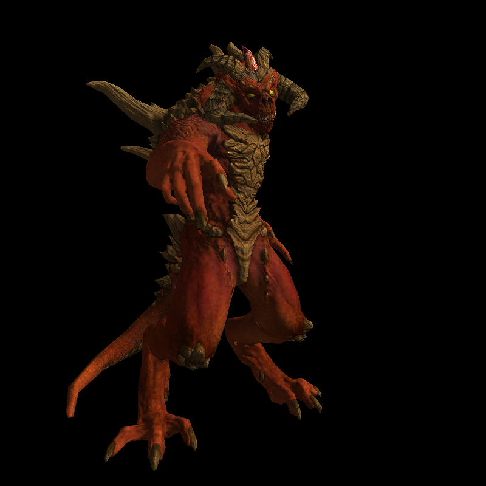
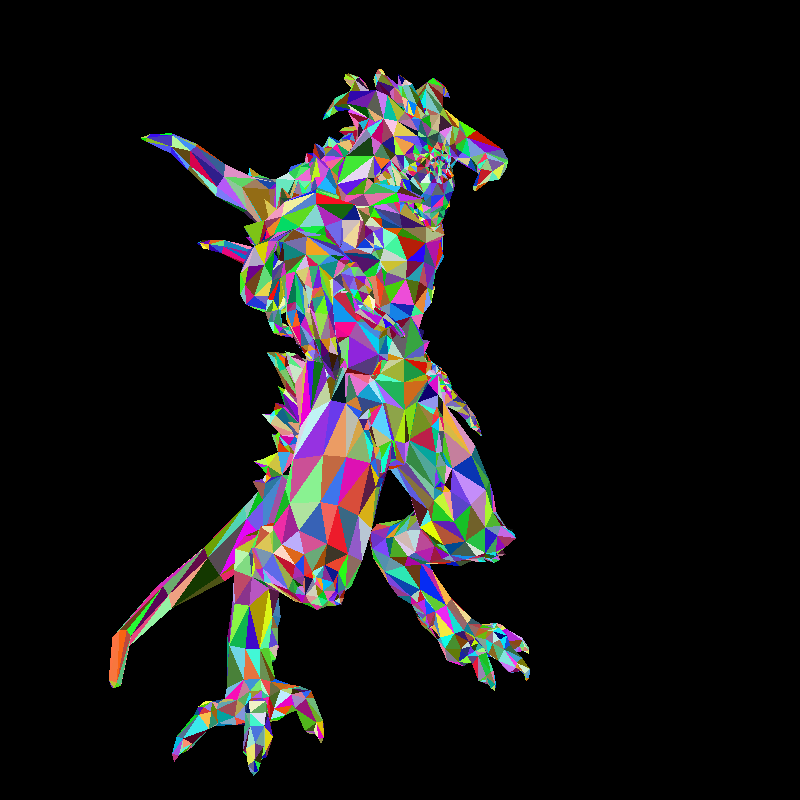
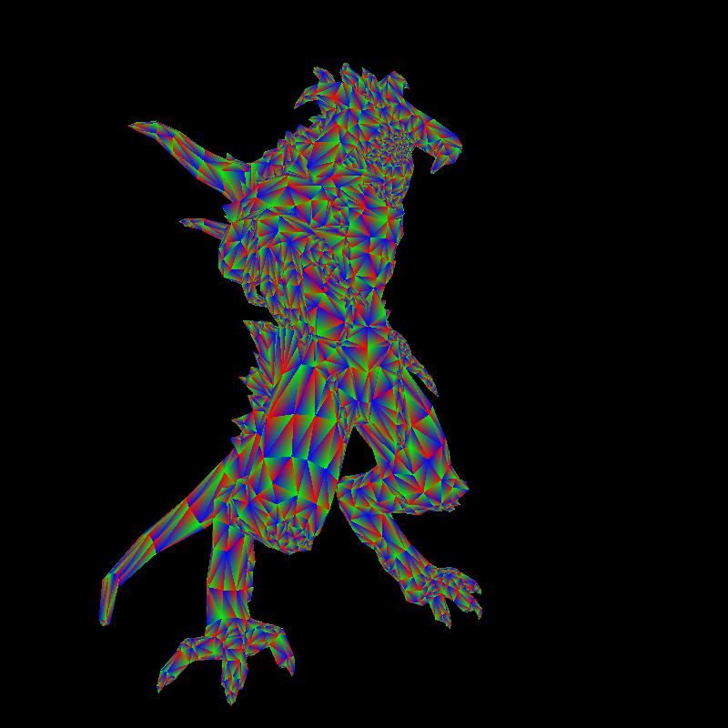
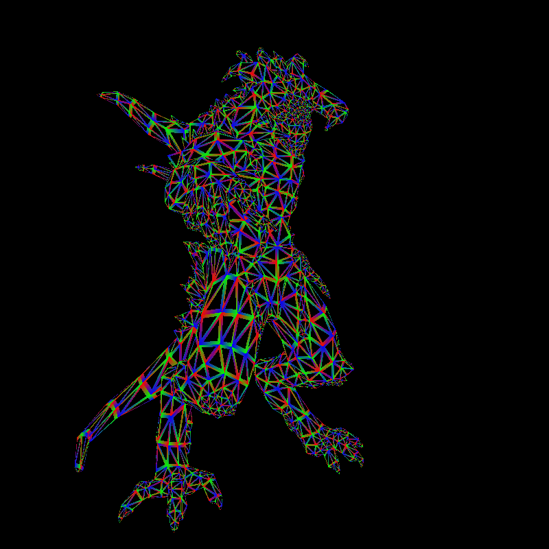
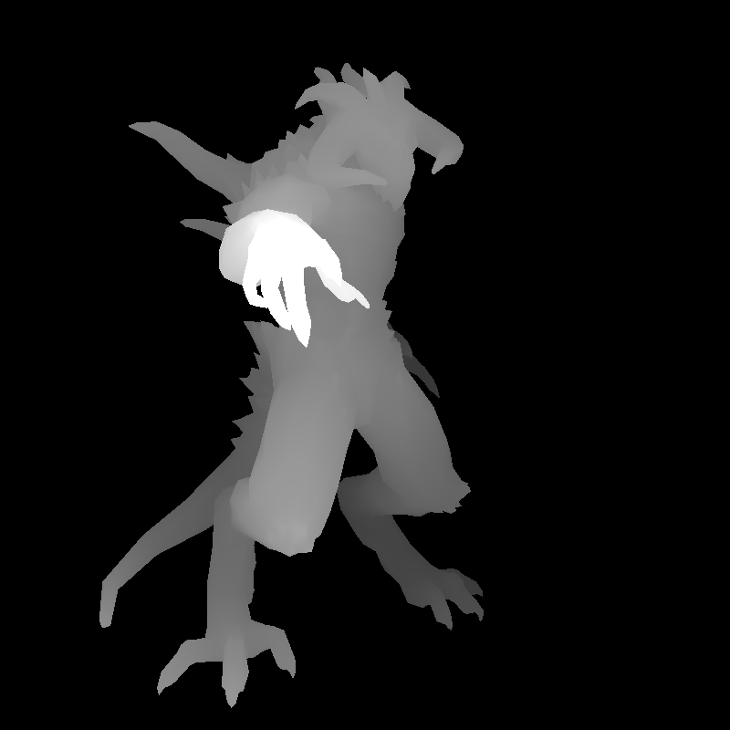

# Not So TinyRenderer

A smol CPU software renderer written in C++20. It loads Wavefront OBJ models, transforms them through a TinyRenderer-style camera pipeline, rasterizes triangles into a TGA framebuffer, and shades the result without using OpenGL, Vulkan, Metal, DirectX, or any GPU rasterization API.

The project is inspired by Dmitry Sokolov's [TinyRenderer tutorial](https://haqr.eu/tinyrenderer/) and expands on it as a learning renderer with a command-line path, an ImGui-based GUI, texture sampling, debug views, and several shader modes.

## Build Requirements

- CMake 3.14 or newer
- A C++20 compiler
- OpenGL development libraries
- Network access during the first CMake configure, because GLFW and ImGui are fetched with CMake `FetchContent`
- Optional: OpenMP for the parallel rasterization experiment

On macOS, OpenMP support usually requires Homebrew `libomp`. The OpenMP path uses CPU threads; it does not move rasterization to the GPU.

## Quick Start

Use the wrapper script to configure CMake, build the executable, and render the default model:

```bash
./run.sh
```

By default this renders:

- Model: `obj/diablo3_pose/diablo3_pose.obj`
- Shader: `phong`
- View mode: `shaded`
- Rasterization: serial CPU path
- Output: `renders/framebuffer.tga`

Open `renders/framebuffer.tga` with an image viewer that supports TGA files.



## GUI Mode

Launch the interactive GUI with:

```bash
./run.sh --gui
```

The GUI discovers models under `obj/`, lets you select meshes, switch view and lighting modes, adjust render settings, and render without retyping command-line options.

For multi-part models, select each OBJ file that should be included in the render. The selected files are rendered in the order shown in the model list.

## Command-Line Usage

Render a single OBJ file by passing the file path:

```bash
./run.sh obj/diablo3_pose/diablo3_pose.obj
```

Render every OBJ file in a directory by passing the directory path:

```bash
./run.sh obj/boggie
```

Directory inputs are searched recursively, then the matching `.obj` paths are sorted before rendering. For `obj/boggie`, the command-line render order is:

```text
obj/boggie/body.obj
obj/boggie/eyes.obj
obj/boggie/head.obj
```

All selected models are drawn into the same framebuffer and z-buffer. That means the order is deterministic, but normal opaque visibility is still decided by depth testing: a later model does not overwrite an earlier one unless its fragments pass the z-buffer test.

### Rendering Options

Use `--shader` to choose the lighting model and `--fill` to choose how triangle fragments are visualized.

| Option | Values | Purpose |
| --- | --- | --- |
| `--shader` | `diffuse`, `phong`, `blinnphong` | Selects the fragment shader used when `--fill shaded` is active |
| `--fill` | `shaded`, `flat`, `depth`, `barycentric`, `wireframe` | Selects the final visualization written to the framebuffer |
| `--output` | Any `.tga` path | Writes the render to a custom output path |

Shader comparison:

| Command | Output |
| --- | --- |
| `./run.sh --shader diffuse` | Ambient plus Lambert diffuse lighting |
| `./run.sh --shader phong` | Diffuse lighting plus reflection-vector specular highlights |
| `./run.sh --shader blinnphong` | Diffuse lighting plus half-vector specular highlights |

| Diffuse | Phong | Blinn-Phong |
| --- | --- | --- |
|  |  |  |

Debug view comparison:

| Command | Output |
| --- | --- |
| `./run.sh --fill flat` | One random color per triangle |
| `./run.sh --fill depth` | Grayscale depth/intensity view |
| `./run.sh --fill barycentric` | Barycentric coordinates as color channels |
| `./run.sh --fill wireframe` | Triangle edges derived from barycentric coordinates |

| Flat (Per-Triangle Random) | Barycentric | Wireframe | Depth |
| --- | --- | --- | --- |
|  |  |  |  |

Show all wrapper options:

```bash
./run.sh --help
```

## Manual Build

The wrapper script is the easiest path, but the project can also be built directly with CMake:

```bash
cmake -S . -B build
cmake --build build -j
build/not_so_tinyrenderer obj/diablo3_pose/diablo3_pose.obj
```

To enable the experimental OpenMP rasterizer:

```bash
cmake -S . -B build -DRASTERIZER_PARALLEL=1
cmake --build build -j
build/not_so_tinyrenderer obj/diablo3_pose/diablo3_pose.obj
```

Use `-DRASTERIZER_PARALLEL=0` to return to the serial baseline.

## Project Layout

```text
.
├── main.cpp              CLI entry point and GUI launch path
├── gui.cpp/.h            ImGui controls
├── renderer.cpp/.h       Render settings, render loop, shader selection
├── notverygl.cpp/.h      Tiny OpenGL-like transform and rasterization helpers
├── model.cpp/.h          OBJ and texture loading
├── modelgroup.cpp/.h     Model discovery/grouping for the GUI
├── mat.h, vec3.h         Math helpers
├── tgaimage.cpp/.h       TGA image IO
├── obj/                  Sample OBJ assets
├── run.sh                Build-and-run wrapper
```

## Renderer Concepts

The renderer follows the same broad shape as a real graphics pipeline, but implemented directly on the CPU:

```text
OBJ mesh data
  -> object-space vertices, normals, UVs, textures
  -> model/view transform
  -> perspective projection
  -> viewport transform
  -> triangle rasterization
  -> barycentric interpolation
  -> z-buffer depth test
  -> fragment shading
  -> TGA framebuffer
```

### Rasterization

Triangles are projected to screen space and filled by scanning a bounding box around each projected triangle. For each candidate pixel, barycentric coordinates decide whether the pixel lies inside the triangle. The same barycentric weights are then reused to interpolate values such as depth, UV coordinates, normals, and debug colors.

### Depth

The depth buffer stores floating-point depth values and starts at negative infinity. Larger depth values are treated as closer to the camera, so a fragment replaces the stored pixel only when its interpolated depth is greater than the current z-buffer value.

### Shading

The shaded path evaluates fragment color after rasterization and depth testing. Depending on the selected shader, it can use ambient light, Lambert diffuse lighting, Phong-style reflection-vector specular highlights, or Blinn-Phong half-vector specular highlights.

The renderer can also sample model textures when the corresponding files are present beside the OBJ asset. Tangent-space normal maps are transformed through a per-triangle TBN frame before lighting; object-space normal maps are transformed into the renderer's lighting space directly.

### View Modes

The same rasterizer can produce final shaded output or diagnostic views. The diagnostic modes expose intermediate data: flat per-triangle color, depth, barycentric weights, and wireframe edges. These are useful for checking whether projection, triangle coverage, and interpolation are behaving as expected.

## Development Roadmap

This is an educational renderer rather than a production rendering engine. The goal is to keep building toward a compact, understandable CPU graphics pipeline while making each milestone visible and testable.

Implemented so far:

- OBJ model loading, including multi-file model groups
- TGA framebuffer output
- Triangle rasterization with barycentric coordinates
- Z-buffered hidden-surface removal
- Camera, perspective, and viewport transforms
- Diffuse, Phong, and Blinn-Phong-style shading
- Diffuse, specular, object-space normal, and tangent-space normal map sampling
- Debug views for flat color, depth, barycentric coordinates, and wireframe edges
- Command-line and GUI render paths
- Serial rendering plus an experimental OpenMP rasterization switch

Active or likely next improvements:

- The OpenMP path can be slower for small triangle workloads because thread setup overhead can dominate the work
- Add perspective-correct interpolation for pre-projection attributes such as UVs, normals, and eye-space positions
- Extend the OBJ loader beyond the bundled TinyRenderer-style assets
- Add shadow mapping
- Alpha handling
- Explore ambient occlusion or another indirect-lighting approximation
- Add toon/cel shading as a stylized rendering mode
- Continue improving GUI controls for comparing models, shaders, and debug views


## References

- [TinyRenderer tutorial](https://haqr.eu/tinyrenderer/)
- [Original TinyRenderer repository](https://github.com/ssloy/tinyrenderer)

### Asset Credits

The sample OBJ models and textures under `obj/` are third-party educational assets used for renderer demos

| Asset | Path | Credit / Source | Usage note |
| --- | --- | --- | --- |
| African head | `obj/african_head/` | Vidar Rapp, via TinyRenderer sample assets | Permission note included in `obj/african_head/readme.txt` |
| Boggie | `obj/boggie/` | Bojana Nedeljkovic | Permission note included in `obj/boggie/readme.txt` |
| Diablo pose | `obj/diablo3_pose/` | Samuel Sharit | Permission note included in `obj/diablo3_pose/readme.txt` |
